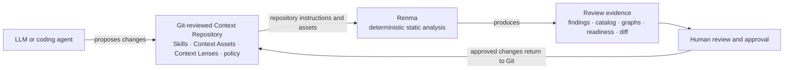

<p align="center">
  
</p>

# Renma - 練磨 in Japanese

[](https://npmjs.org/package/renma)
[](https://npmjs.org/package/renma)

Renma is a Git-native Context Repository and deterministic governance CLI for
agent-facing knowledge and its static repository declarations. It keeps Skills,
Context Assets, Context Lenses, ownership, lifecycle, provenance, security
policy, declared relationships, and review evidence maintainable in Git. Renma
analyzes and reports repository state; it is not the runtime that consumes
these assets.

### You May Need Renma When

- Guidance is copied across Skills, prompts, or repository instructions.
- Nobody can identify the authoritative version or owner.
- Skills or Context Assets reference files that moved or became inactive.
- Reviewers cannot see which agent-facing knowledge or relationships changed.
- Repository policy and operational instructions have drifted apart.

## Why A Context Repository?

A Context Repository provides Git-reviewed governance for reusable knowledge
that LLMs and agents can consume. A Context Asset is a Git-reviewed governance
entry point for independently maintained knowledge and its authoritative
sources. It gives that knowledge a stable identity, owner, lifecycle, and
explicit relationships instead of leaving it copied across prompts or buried
in one workflow.

The authoritative content may live directly in the Context Repository or in an
external governed system, including another Git repository, a documentation or
specification system, or Confluence. Renma does not require duplicating
external source material into `contexts/`. A reviewed source reference is not
proof that the source was consulted, validation of its contents, permission to
access it, or a runtime dependency for Renma.

Cross-Skill reuse is one reason to create a Context Asset. Independent
ownership, lifecycle, maintenance, or source-of-truth responsibility is also
sufficient. Knowledge that exists only to explain one Skill remains in that
Skill or justified Skill-local support.

Renma operationalizes this model through deterministic repository evidence. It
is not a prompt library, vector database, memory service, RAG replacement, or
generic Markdown linter. See the
[Context Repository notes](https://kazucocoa.blog/context-repository/) for the
broader framing.

## What Renma Checks

Renma reviews discovered agent-facing repository assets and produces
deterministic evidence for humans, CI, and coding agents. `renma scan` is the
normal starting point; focused commands expose the related inventory, graph,
ownership, readiness, and change evidence.

| Area | Examples |
| --- | --- |
| Skills and layout | Canonical entrypoints, metadata, historical paths, and support-directory boundaries. |
| Governance | Identity, ownership, lifecycle, freshness, required metadata, and security profiles. |
| Relationships and support | Missing, inactive, conflicting, or cyclic dependencies; broken references; unreachable support. |
| Authoring quality | Selection boundaries, inputs, verification guidance, scaffold residue, local paths, token budgets, and mixed responsibilities. |
| Security | Policy violations, sensitive-data exposure, risky commands and dependencies, untrusted instructions, and hidden Unicode. |
| Review coverage | Inspected files, blocked paths, analysis layers, and unsupported or ambiguous formats. |

Security checks apply to documented, supported forms in agent-facing
instructions and metadata. They do not perform general code SAST, CVE lookup,
dependency-content validation, complete secret scanning of executable code, or
runtime permission enforcement. See the
[Security Policy Guide](docs/security-policy.md) for the effective-policy and
instruction-analysis boundary, and the
[Diagnostics Reference](docs/diagnostics.md) for current finding identifiers
and remediation guidance.

## Product Boundary

Renma discovers, parses, normalizes, validates, compares, and reports
repository assets. It does not:

- call an LLM for core analysis;
- select a live Skill, Context Asset, or Context Lens;
- retrieve or load assets for a live task;
- assemble prompts, bundle assets, or inject Context;
- execute Skills, agents, workflows, or operational commands found in repository
  instructions;
- collect runtime telemetry;
- perform general-purpose SAST or arbitrary language data-flow analysis;
- rewrite repository semantics or weaken policy automatically; or
- provide hosted gateways or dashboards.

Security analysis is bounded to supported forms in agent-facing instructions
and metadata. Unsupported or ambiguous syntax follows conservative fallback.
Use language-specific SAST, dependency, and secret-scanning tools for executable
code. Scan JSON reports per-artifact security-analysis coverage separately from
repository inspection coverage, including unsupported semantic formats. A
clean Renma scan is repository evidence, not a security proof.

The review boundary is:

```text
LLM investigates and proposes. Renma validates deterministic structure and repository evidence. Human reviews and approves.
```



## Agent Skills And Renma

Canonical Agent Skills entrypoints use `SKILL.md` under either recognized root:

- `skills/**/SKILL.md`
- `.agents/skills/**/SKILL.md`

The `**` notation is shorthand, not an unconditional path grammar: no segment
between the Skill root and `SKILL.md` may be a reserved Skill-support directory.
See the precise [entrypoint path contract](docs/agent-skills-compatibility.md#entrypoint-paths).

Repository walking reports historical `skill.md` and `*.skill.md` spellings
with migration guidance, but they are never operational Skills and do not
participate in ownership, policy inheritance, catalog relationships, or Skill
Discovery. Run `suggest-metadata` explicitly on one of those paths to obtain a
reviewable rename or move candidate. Canonical Skills use specification-valid Agent Skills
frontmatter plus flat, string-valued `metadata.renma.*` governance and security
fields. See
[Agent Skills Compatibility and Migration](docs/agent-skills-compatibility.md)
for the exact current and compatibility forms.

For new Skills, use the [authoring flow below](#create-a-skill-interactively).
The [Authoring Guide](docs/authoring-guide.md) defines the creation gate,
structured handoff, and existing-Skill maintenance workflow. Platform-native
Skill guidance may refine semantics within the agreed asset graph; Renma owns
its metadata, Context placement, and source-of-truth boundaries.

## Install And Quick Start

Run the published CLI without a global installation:

```bash
npx renma scan . --fail-on high
npx renma catalog . --format markdown
npx renma graph . --format markdown
npx renma readiness . --format markdown
```

Renma supports the current Node.js engine range on Linux, macOS, and Windows.
The same deterministic repository contract applies on all three platforms,
including native path/filesystem handling, packaged CLI startup, and bounded
POSIX shell, PowerShell, and Windows batch evidence. Renma analyzes those
command forms as repository text; it does not require their interpreters to be
installed and never executes them during a scan.

`renma init` initializes repository-level Renma configuration. It does not
create Skills or Context Assets. Existing repositories can use built-in
defaults without running `renma init`; use initialization only when the
repository wants to record explicit adoption:

```bash
npx renma init .
```

`renma scaffold` creates one explicitly requested Skill, Context Asset, or
Context Lens after its responsibility and boundary have been decided. It does
not initialize repository configuration.

### Create a Skill interactively

You can start with this request to a coding agent:

```text
I want to create a Skill with `renma guide skill`.
```

The normal sequence is:

```bash
npx renma guide skill
# The LLM investigates and clarifies only if needed, establishes every gate
# requirement including the smallest justified asset structure, then declares
# the gate passed and writes renma.skill-authoring-handoff.v1 to:
# /tmp/spec-review-handoff.json
npx renma scaffold skill skills/testing/spec-review/SKILL.md --handoff /tmp/spec-review-handoff.json
# Use platform-native Skill authoring guidance within the agreed boundaries.
npx renma scan . --fail-on high
npx renma catalog . --format markdown
npx renma graph . --format markdown
```

This coding-agent authoring flow uses the structured handoff. Direct or manual
scaffold usage that does not use the agent authoring handoff may continue to use
`--owner`.

For an existing Skill:

```bash
npx renma scan . --fail-on high
npx renma inspect skills/testing/spec-review/SKILL.md
# Use suggest-metadata only for a supported retrofit or one-way migration.
npx renma suggest-metadata skills/testing/spec-review/SKILL.md
npx renma scan . --fail-on high
```

Use `renma guide skill` only when the work intentionally reconsiders Skill and
Context responsibilities, file or resource boundaries, sources of truth,
scripts, or the asset graph. Ordinary maintenance starts with `scan`.
`suggest-metadata` and `suggest-semantic-split` print reviewable guidance; they
do not edit the target.

Inspect one file or an exact one-based inclusive line range:

```text
renma inspect <file>
renma inspect <file> --lines L10-L42
```

When developing from this checkout:

```bash
npm install
npm run build
node dist/index.js scan . --fail-on high
```

### Library imports

The package exposes stable types, pure discovery helpers, and a read-only
asset-binding API for external builders:

```ts
import type { ScanJsonDocument } from "renma/types";
import { classifyAssetPath } from "renma/discovery";
```

`ScanJsonDocument` describes `scan --format json` with
`schemaVersion: "renma.scan.v2"`. Focused type entrypoints are
`renma/types/classification`, `renma/types/diagnostics`, and
`renma/types/scan-result`. See [JSON compatibility](docs/machine-readable-json.md)
for wire contracts and [Asset Bindings](docs/asset-bindings.md) for
`renma/asset-bindings`.

The package root is the CLI entrypoint. Commands, renderers, runtime models,
and `renma/dist/...` imports remain private; unsupported package subpaths are
rejected with `ERR_PACKAGE_PATH_NOT_EXPORTED`.

## Command Overview

| Command | Main question |
| --- | --- |
| `init` | How can this repository record explicit Renma adoption? |
| `scan` | What concrete problems should be fixed? |
| `catalog` | What assets and metadata exist? |
| `graph` | How are assets and executable relationships connected? |
| `execution-contract` | What executable relationships are statically possible from one Skill? |
| `skill-index` | Where can static Skill Discovery begin and continue? |
| `trust-graph` | What trust-relevant evidence is connected to each asset? |
| `readiness` | Is the repository broadly prepared for agent-facing use? |
| `bom` | What declared Repository Context BOM should be reviewed? |
| `ownership` | Where is ownership missing or concentrated? |
| `diff` | What deterministic repository evidence changed between refs? |
| `ci-report` | What should a CI or pull-request reviewer inspect? |
| `inspect` | What is the outline or exact line slice of one file? |
| `guide` | What authoring contract should precede a new Skill? |
| `scaffold` | How can one agreed asset start from a deterministic structure? |
| `suggest-metadata` | What retrofit or one-way Skill migration is safe to review? |
| `suggest-semantic-split` | How can a mixed-purpose asset be split reviewably? |

Run `renma --help` and `renma <command> --help` for the authoritative usage,
options, formats, examples, and exit behavior. The
[User Manual](docs/user-manual.md#authoritative-metadata-reference) owns the
complete operational metadata reference, and the manual's command sections own
the operational command reference.

## Repository Conventions

An illustrative repository layout is:

```text
skills/
  testing/
    spec-review/
      SKILL.md
      references/
      scripts/
contexts/
  testing/
    boundary-value-analysis.md
lenses/
  testing/
    spec-review-boundary-values.md
renma.config.jsonc
```

`renma.config.jsonc` is the recommended repository configuration filename.
JSONC is JSON with comments, so maintainers can preserve why a governance
policy is temporarily relaxed without introducing executable configuration.
`renma.config.json` is the other supported v1 filename. A legacy `.renma.json`
is rejected with guidance to rename it; Renma does not support or execute
`.mjs` configuration.

Repository policy is optional and explicit. The
[User Manual configuration reference](docs/user-manual.md#configuration) owns
supported keys, defaults, validation, and complete examples:

| Policy | Purpose |
| --- | --- |
| `metadata.required` | Require explicit metadata declarations; inherited ownership does not satisfy a required declaration. |
| `diagnostics.severity` | Override supported Finding severities used by `fail_on`; suppressions remain separately reviewed exceptions. |
| `quality` | Configure token-budget warning and High thresholds by asset kind. See the [Quality Profile](docs/quality-profile.md) for measurements and rationale. |
| `security`, `scan_boundary`, `executable_surface`, `skill_discovery` | Govern security, inspection coverage, executable changes, and declared Discovery routes. |

`ci-report` applies each policy's review rules. Metadata, diagnostic-severity,
and quality policies use the stricter archived endpoint mode to govern
weakening, including disabling their CI gate. See the
[CI report reference](docs/user-manual.md#ci-report) for each policy's scope.
Lifecycle states and their effects are covered in
[Context Lifecycle Diagnostics](docs/context-lifecycle-diagnostics.md).

`contexts/**` is the only independently governed Context Asset root;
`context/**` receives migration guidance and is not interpreted. Canonical
Skill-local support directories are `references/`, `profiles/`, `examples/`,
`scripts/`, and `assets/`. Their placement supplies only a parent candidate.
Cataloged local support may inherit effective ownership only when repository
evidence resolves exactly one owning Skill. Of those support kinds, only
`script` and `asset` artifacts inherit the owning Skill's effective security
policy by placement. Missing or ambiguous parents fail closed.

Top-level `tools/**` is repository implementation, not Context. Top-level
`references/**` is not a Context root, and `skills/**/tools/**` is not canonical
Skill-local support.

## Documentation

- [Documentation index](docs/README.md): all guides, contracts, schemas, and development documents.
- [User Manual](docs/user-manual.md): configuration, metadata, and CLI reference.
- [Authoring Guide](docs/authoring-guide.md): create and maintain Skills and Context Assets.
- [Diagnostics Reference](docs/diagnostics.md) and [Security Policy Guide](docs/security-policy.md): interpret findings and policy evidence.
- [Changelog](CHANGELOG.md) and [Examples](https://github.com/KazuCocoa/renma/tree/main/examples).

Development architecture, design, and roadmap documents are
[source-repository-only](docs/README.md#development) and excluded from the npm
package.
